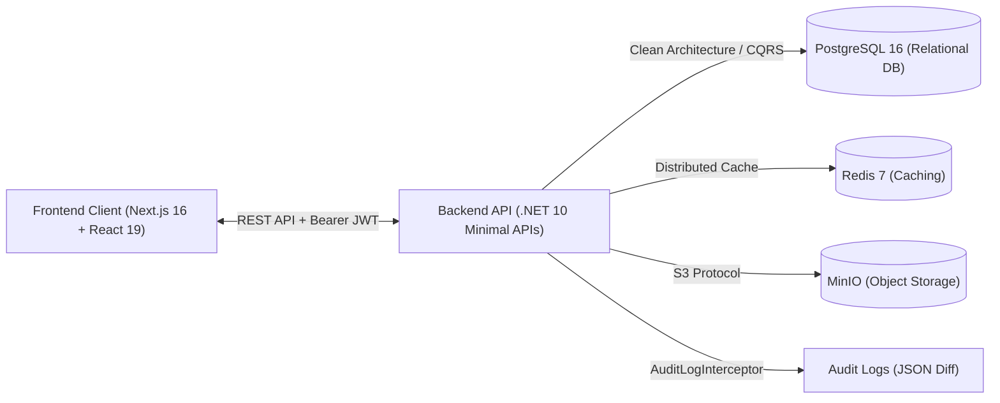
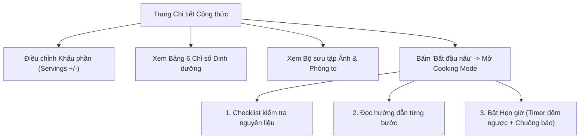

# 📖 SỔ TAY HƯỚNG DẪN SỬ DỤNG DỰ ÁN CULINARY BLOG
> **Nền tảng Blog & Chia sẻ Công thức Ẩm thực Trực tuyến Đa phân quyền**  
> **Phiên bản hệ thống**: v1.0 (Hoàn thiện Lab 01 – Lab 08)  
> **Nhóm thực hiện**: Nhóm 14 (PTUDWEBNC)

---

## 📑 MỤC LỤC
1. [Giới thiệu Tổng quan Dự án](#1-giới-thiệu-tổng-quan-dự-án)
2. [Kiến trúc & Công nghệ Sử dụng](#2-kiến-trúc--công-nghệ-sử-dụng)
3. [Hướng dẫn Khởi động Hệ thống (Quick Start)](#3-hướng-dẫn-khởi-động-hệ-thống-quick-start)
4. [Tài khoản Thử nghiệm & Tiện ích Demo 1-Click](#4-tài-khoản-thử-nghiệm--tiện-ích-demo-1-click)
5. [Hướng dẫn Chi tiết Từng Module Chức năng](#5-hướng-dẫn-chi-tiết-từng-module-chức-năng)
   - [5.1. Phân hệ Xác thực & Hồ sơ Cá nhân (Auth & Profile)](#51-phân-hệ-xác-thực--hồ-sơ-cá-nhân-auth--profile)
   - [5.2. Phân hệ Khám phá & Tìm kiếm Công thức (Reader/Public)](#52-phân-hệ-khám-phá--tìm-kiếm-công-thức-readerpublic)
   - [5.3. Trải nghiệm Chi tiết Công thức & Chế độ Nấu ăn (Cooking Mode)](#53-trải-nghiệm-chi-tiết-công-thức--chế-độ-nấu-ăn-cooking-mode)
   - [5.4. Phân hệ Tác giả Viết bài & Quản lý Công thức (Author/Chef)](#54-phân-hệ-tác-giả-viết-bài--quản-lý-công-thức-authorchef)
   - [5.5. Phân hệ Quản trị Toàn diện (Admin Module)](#55-phân-hệ-quản-trị-toàn-diện-admin-module)
     - [5.5.1. Quản lý Người dùng & Phân quyền RBAC](#551-quản-lý-người-dùng--phân-quyền-rbac-dashboardusers)
     - [5.5.2. Quản trị Danh mục & Upload Ảnh](#552-quản-trị-danh-mục--upload-ảnh-dashboardcategories)
     - [5.5.3. Nhật ký Kiểm toán Hệ thống (Audit Logs)](#553-nhật-ký-kiểm-toán-hệ-thống-audit-logs-dashboardlogs)
6. [Kịch bản Kiểm thử Hệ thống (Testing Guide)](#6-kịch-bản-kiểm-thử-hệ-thống-testing-guide)
7. [Xử lý Sự cố Thường gặp (Troubleshooting FAQ)](#7-xử-lý-sự-cố-thường-gặp-troubleshooting-faq)

---

## 1. Giới thiệu Tổng quan Dự án

**Culinary Blog** là một nền tảng web hiện đại phục vụ cộng đồng đam mê ẩm thực, cho phép:
- **Người dùng yêu thích nấu ăn (User/Reader)**: Tìm kiếm món ăn thông minh theo nguyên liệu, lọc danh mục, xem chi tiết công thức, tự động co giãn khẩu phần ăn (`Servings`) và trải nghiệm chế độ nấu ăn từng bước toàn màn hình (`Cooking Mode`) với đồng hồ bấm giờ tích hợp.
- **Đầu bếp & Tác giả (Author/Chef)**: Soạn thảo công thức đa bước (Wizard), tải ảnh thực tế lên MinIO S3 Object Storage, quản lý vòng đời công thức (`Draft` $\rightarrow$ `Published` $\rightarrow$ `Archived`), bảo vệ chống ghi đè đồng thời (`RowVersion`).
- **Quản trị viên (Admin)**: Quản lý người dùng, phân quyền RBAC (Admin/Author/User), khóa/mở khóa tài khoản thu hồi phiên đăng nhập tức thì, quản lý danh mục món ăn và giám sát toàn bộ hoạt động hệ thống qua **Nhật ký kiểm toán (Audit Logs)**.

---

## 2. Kiến trúc & Công nghệ Sử dụng



- **Backend**: C# .NET 10, Clean Architecture, CQRS với MediatR, Minimal APIs, EF Core 10 (Npgsql), ASP.NET Identity, Serilog Structured Logging.
- **Frontend**: Next.js 16 (App Router), TypeScript, Tailwind CSS, shadcn/ui, TanStack Query v5, Zustand, NextAuth / Auth.js v5.
- **Cơ sở dữ liệu & Lưu trữ**:
  - **PostgreSQL 16**: Lưu trữ quan hệ, Full-Text Search tiếng Việt với `unaccent` và GIN Index.
  - **Redis 7**: Distributed Cache cho các danh mục và bài viết hot.
  - **MinIO**: S3 Object Storage lưu trữ ảnh đại diện, ảnh bài viết với bucket policy `public-read`.
- **Bảo mật**:
  - JWT Bearer Token Rotation (Access Token 15 phút, Refresh Token SHA-256 kèm cơ chế phát hiện đánh cắp Token Theft Detection).
  - Phân quyền theo vai trò (RBAC), kiểm soát tài nguyên tránh lỗ hổng BOLA (OWASP API1).
  - Rate Limiting, CORS Policy, Security Headers (CSP, HSTS, X-Frame-Options).

---

## 3. Hướng dẫn Khởi động Hệ thống (Quick Start)

### 3.1. Yêu cầu Môi trường
- Hệ điều hành: Windows / macOS / Linux.
- **Docker Desktop** (hoặc Docker Engine) đang bật.
- **.NET 10 SDK** (hoặc .NET 9+ tương thích).
- **Node.js 20+** và npm.

### 3.2. Các bước Khởi chạy

#### Bước 1: Khởi động các dịch vụ Docker (PostgreSQL, Redis, MinIO)
Mở PowerShell / Terminal tại thư mục `culinary-blog/`:
```bash
docker compose up -d postgres redis minio
```
> Kiểm tra các container đang chạy bằng lệnh: `docker ps`. Các cổng mặc định:
> - PostgreSQL: `localhost:5432`
> - Redis: `localhost:6379`
> - MinIO API: `http://localhost:9000` — Console MinIO: `http://localhost:9001` (User: `admin`, Password: `password123`)

#### Bước 2: Khởi động Backend API (.NET 10)
```bash
cd src/backend/src/CulinaryBlog.API
dotnet run --urls "http://localhost:5075"
```
> Backend sẽ tự động chạy EF Core Migration và nạp dữ liệu mẫu (Seeder).
> - Kiểm tra tình trạng: `http://localhost:5075/health` $\rightarrow$ trả về `"Healthy"`.
> - Xem tài liệu Scalar OpenAPI 3.1: `http://localhost:5075/scalar/v1`.

#### Bước 3: Khởi động Frontend (Next.js 16)
Mở một cửa sổ Terminal khác:
```bash
cd src/frontend
npm run dev
```
> Truy cập ứng dụng tại: **`http://localhost:3000`**.

---

## 4. Tài khoản Thử nghiệm & Tiện ích Demo 1-Click

Để hỗ trợ việc chấm điểm và trải nghiệm kiểm thử nhanh chóng, cơ sở dữ liệu đã được seed sẵn các tài khoản tương ứng với 3 vai trò:

| Vai trò | Email đăng nhập | Mật khẩu mặc định | Quyền hạn chính |
| :--- | :--- | :--- | :--- |
| **Quản trị viên (Admin)** | `admin@culinary.com` | `Password123!` | Toàn quyền quản trị: Quản lý người dùng, phân quyền RBAC, khóa tài khoản, quản trị danh mục, xem nhật ký kiểm toán hệ thống. |
| **Tác giả / Đầu bếp (Author)** | `chef.hieu@culinary.com` | `Password123!` | Thêm món mới (`/recipes/new`), quản lý/sửa bài viết cá nhân, chuyển trạng thái bài viết (`Draft` $\rightarrow$ `Published` $\rightarrow$ `Archived`). |
| **Tác giả / Đầu bếp (Author)** | `chef.khai@culinary.com` | `Password123!` | Tài khoản tác giả ẩm thực chuyên món chay. |
| **Thành viên (User)** | `member.huy@culinary.com` | `Password123!` | Xem công thức, tìm kiếm, lưu bài viết yêu thích (`Bookmarks`), trải nghiệm chế độ nấu ăn. |

### ⚡ Tiện ích "Demo 1-Click" trên trang Đăng nhập
1. Truy cập: `http://localhost:3000/login`.
2. Phía dưới form đăng nhập có khu vực **"Demo 1-Click (Dành cho chấm điểm)"** với 3 nút bấm:
   - 🛡️ **Admin**: Đăng nhập ngay lập tức với quyền Quản trị viên.
   - 👨‍🍳 **Author**: Đăng nhập ngay lập tức với quyền Tác giả (Bùi Trung Hiếu).
   - 👤 **User**: Đăng nhập ngay lập tức với quyền Thành viên (Phan Thành Huy).
3. Chỉ cần **1 cú click chuột**, hệ thống tự động xác thực và chuyển hướng vào Dashboard mà không cần gõ mật khẩu.

---

## 5. Hướng dẫn Chi tiết Từng Module Chức năng

### 5.1. Phân hệ Xác thực & Hồ sơ Cá nhân (Auth & Profile)

#### Đăng nhập & Đăng ký
- **Đăng nhập (`/login`)**:
  - Hỗ trợ nhập Email/Mật khẩu hoặc dùng **Demo 1-Click**.
  - Tích hợp ghi nhớ phiên đăng nhập (7 ngày).
  - Nút Đăng nhập nhanh bằng **Google OAuth 2.0**.
- **Đăng ký (`/register`)**:
  - Form nhập Họ tên, Email, Mật khẩu.
  - Tích hợp **Thanh đo độ mạnh mật khẩu (Password Strength Meter)** kiểm tra độ an toàn mật khẩu thời gian thực.
- **Quên mật khẩu & Đặt lại mật khẩu (`/forgot-password` & `/reset-password`)**:
  - Gửi yêu cầu cấp lại mã xác thực và đặt mật khẩu mới chuẩn RFC 7807.

#### Hồ sơ Cá nhân & Bảo mật
- **Trang hồ sơ cá nhân (`/profile`)**:
  - Xem thông tin tài khoản, ngày tham gia, vai trò, tổng số công thức đã xuất bản.
  - Nhấn **"Chỉnh sửa hồ sơ"** để cập nhật tên hiển thị, tiểu sử (`Bio`) và link ảnh đại diện.
- **Đổi mật khẩu (`/dashboard?tab=security`)**:
  - Nhập mật khẩu hiện tại và mật khẩu mới để đổi mật khẩu trực tiếp.
- **Đăng xuất an toàn**:
  - Bấm nút **"Đăng xuất"** tại Menu tài khoản ở Header hoặc góc dưới Sidebar Dashboard. Hệ thống sẽ tự động gọi Backend để thu hồi Refresh Token, xóa sạch Cache/Session ở Client và điều hướng về trang Login.

---

### 5.2. Phân hệ Khám phá & Tìm kiếm Công thức (Reader/Public)

#### 1. Trang chủ (`/`)
- Header tích hợp thanh điều hướng: **Khám phá**, **Danh mục**, **Đầu bếp**, thanh Tìm kiếm nhanh và nút Đăng nhập / Menu hồ sơ.
- Sidebar danh mục bên trái giúp lọc nhanh công thức theo: *Món chính*, *Món chay*, *Món tráng miệng*, *Đồ uống*.
- Lưới công thức (`RecipeGrid`) hiển thị thẻ món ăn (`RecipeCard`) gồm: Ảnh bìa sắc nét, nhãn danh mục, độ khó, thời gian chuẩn bị/nấu, số lượt yêu thích và tên tác giả.

#### 2. Tìm kiếm Công thức Nâng cao (`/recipes`)
- Nhập từ khóa tiếng Việt có dấu hoặc không dấu (nhờ mở rộng PostgreSQL `unaccent` và GIN Index).
- Hỗ trợ tìm kiếm theo tiêu đề, mô tả và cả nội dung trong các bước hướng dẫn.
- Lọc kết hợp: Lọc theo danh mục, độ khó (*Dễ, Trung bình, Khó*), sắp xếp theo *Mới nhất, Xem nhiều nhất, Thời gian nấu nhanh nhất*.

#### 3. Danh mục Món ăn (`/categories`)
- Hiển thị danh sách tất cả danh mục ẩm thực dạng thẻ lớn kèm ảnh minh họa và thống kê số lượng bài viết đang hoạt động trong từng danh mục.

#### 4. Danh sách Tác giả Ẩm thực (`/authors`)
- Trang danh bạ đầu bếp công khai.
- Xem danh sách các tác giả nổi bật kèm avatar, giới thiệu, số bài viết đã đăng.
- Sắp xếp tác giả theo *Số bài viết nhiều nhất* hoặc *Ngày tham gia*.

---

### 5.3. Trải nghiệm Chi tiết Công thức & Chế độ Nấu ăn (Cooking Mode)

Khi bấm vào một món ăn bất kỳ, bạn sẽ vào trang chi tiết (`/recipes/[id]`):



#### 1. Điều chỉnh Khẩu phần ăn Thông minh (`Servings`)
- Tại khu vực **Nguyên liệu**, có bộ điều khiển số người ăn: `[-]  4 người  [+]`.
- Khi bạn tăng hoặc giảm số lượng người ăn, toàn bộ định lượng nguyên liệu (ví dụ: *500g thịt, 2 muỗng nước mắm*) sẽ **tự động nhân/chia tương ứng** theo thời gian thực.

#### 2. Bảng 6 Chỉ số Dinh dưỡng Chuẩn hóa
- Hiển thị chi tiết theo từng khẩu phần:
  - **Calo (Calories)** (kcal)
  - **Chất đạm (Protein)** (g)
  - **Chất bột đường (Carbohydrates)** (g)
  - **Chất béo (Fat)** (g)
  - **Chất xơ (Fiber)** (g)
  - **Natri (Sodium)** (mg)

#### 3. Chế độ Nấu ăn Tương tác Toàn màn hình (`Cooking Mode`)
- Bấm nút **"Bắt đầu nấu"** màu cam nổi bật trên ảnh bìa:
  - Giao diện chuyển sang chế độ tập trung toàn màn hình, chữ to rõ ràng, không bị xao nhãng.
  - **Checklist nguyên liệu**: Cho phép tích chọn nguyên liệu nào đã chuẩn bị xong.
  - **Hướng dẫn từng bước**: Có nút **"Bước trước"** / **"Bước tiếp theo"** kèm thanh tiến độ hoàn thành (% Progress).
  - **Đồng hồ bấm giờ (`Timer Countdown`)**: Với những bước có cài đặt thời gian (ví dụ: ninh xương 45 phút, xào 5 phút), hệ thống hiển thị đồng hồ đếm ngược trực quan, có nút Bắt đầu / Tạm dừng và chuông thông báo khi hết giờ.

---

### 5.4. Phân hệ Tác giả Viết bài & Quản lý Công thức (Author/Chef)

*(Áp dụng cho tài khoản có quyền `Author` hoặc `Admin`)*

#### 1. Bảng Quản trị Bài viết Cá nhân (`/dashboard`)
- Xem danh sách toàn bộ công thức do mình tạo ra.
- Lọc theo 4 trạng thái:
  - **Tất cả**: Toàn bộ công thức.
  - **Đã xuất bản (Published)**: Công thức đang hiển thị công khai cho mọi người đọc.
  - **Bản nháp (Draft)**: Công thức đang soạn thảo dở, chưa công khai.
  - **Lưu trữ (Archived)**: Công thức tạm ẩn khỏi trang chủ.
- **Thao tác nhanh trên từng thẻ bài viết**:
  - Bấm **"Chỉnh sửa"**: Mở trang sửa công thức.
  - Bấm **"Xuất bản"**: Chuyển ngay công thức từ `Draft` sang `Published`.
  - Bấm **"Lưu trữ"**: Chuyển từ `Published` sang `Archived`.
  - Bấm **"Xóa"**: Xóa mềm công thức (vẫn bảo toàn toàn vẹn dữ liệu trong cơ sở dữ liệu).

#### 2. Thêm mới Công thức qua Wizard Đa bước (`/recipes/new`)
Giao diện tạo công thức gồm 4 bước trực quan:
- **Bước 1: Thông tin cơ bản**:
  - Tiêu đề món ăn, mô tả ngắn, danh mục, mức độ khó (*Dễ, Trung bình, Khó*), thời gian chuẩn bị, thời gian nấu, khẩu phần ăn ban đầu.
  - **Kéo thả Tải ảnh bìa (`ImageUploader`)**: Kéo ảnh từ máy tính thả vào khung, kiểm tra dung lượng tối đa (5MB), định dạng (JPG, PNG, WebP) và xem trước tức thì. Ảnh sẽ được upload an toàn lên MinIO S3 Object Storage.
- **Bước 2: Nguyên liệu**:
  - Bấm nút "Thêm nguyên liệu", điền tên nguyên liệu, định lượng, đơn vị đo (gam, muỗng, quả...), ghi chú chuẩn bị.
- **Bước 3: Các bước thực hiện**:
  - Thêm từng bước nấu, nhập tiêu đề bước, mô tả cách làm chi tiết, nhập số phút hẹn giờ (`TimerMinutes`).
- **Bước 4: Dinh dưỡng & Hoàn tất**:
  - Nhập 6 chỉ số dinh dưỡng (Calo, Protein, Carb, Fat, Fiber, Sodium).
  - Tùy chọn nút: **"Lưu bản nháp" (Draft)** để sửa sau hoặc **"Xuất bản ngay" (Published)**.

#### 3. Chỉnh sửa Công thức (`/recipes/[id]/edit`)
- Tải toàn bộ dữ liệu hiện tại của công thức lên form.
- Hỗ trợ thêm/xóa ảnh, thay đổi ảnh chính (`isPrimary`).
- **Kiểm soát xung đột đồng thời (`Optimistic Concurrency - RowVersion`)**: Nếu có hai người cùng chỉnh sửa một bài viết cùng lúc, hệ thống sẽ cảnh báo lỗi xung đột phiên bản để chống việc ghi đè mất dữ liệu.

---

### 5.5. Phân hệ Quản trị Toàn diện (Admin Module)

*(Chỉ hiển thị và cho phép truy cập với tài khoản có quyền `Admin`)*

#### 5.5.1. Quản lý Người dùng & Phân quyền RBAC (`/dashboard/users`)
- **Danh sách người dùng**: Hiển thị bảng danh sách toàn bộ thành viên trong hệ thống kèm avatar, tên, email, ngày đăng ký, vai trò hiện tại, trạng thái hoạt động và số lượng công thức đã đăng.
- **Tìm kiếm & Lọc**: Tìm nhanh theo tên hoặc email, lọc theo vai trò (`Admin`, `Author`, `User`) hoặc trạng thái (`Đang hoạt động`, `Bị khóa`).
- **Phân quyền vai trò trực tiếp (RBAC)**:
  - Chọn trực tiếp tại cột **Vai trò** để đổi quyền giữa `Admin`, `Author`, `User`.
  - Hệ thống tích hợp cơ chế bảo vệ: Không cho phép Admin tự hạ quyền của chính mình.
- **Khóa / Mở khóa tài khoản & Thu hồi phiên đăng nhập**:
  - Bấm nút **Khóa**: Chọn số ngày khóa (ví dụ: 7 ngày, 30 ngày) và nhập lý do khóa.
  - Khi tài khoản bị khóa, hệ thống **tự động thu hồi toàn bộ Refresh Token** đang lưu hành của tài khoản đó. Ngay lập tức người dùng bị khóa sẽ bị đẩy ra màn hình đăng nhập nếu đang trực tuyến.
  - Bấm nút **Mở khóa** để kích hoạt lại tài khoản.

#### 5.5.2. Quản trị Danh mục & Upload Ảnh (`/dashboard/categories`)
- Xem danh sách các danh mục món ăn hiện có kèm ảnh đại diện, `slug`, thứ tự ưu tiên (`OrderIndex`) và số lượng công thức thuộc danh mục.
- **Thêm danh mục mới**:
  - Nhập tên danh mục: Hệ thống tự động chuyển đổi thành `slug` tiếng Việt chuẩn SEO (ví dụ: *"Món tráng miệng"* $\rightarrow$ *"mon-trang-mieng"*).
  - Nhập mô tả, thứ tự hiển thị.
  - Tải ảnh đại diện danh mục qua component kéo-thả `ImageUploader` (tải lên MinIO).
- **Chỉnh sửa danh mục**: Cập nhật tên, mô tả, thứ tự hoặc thay đổi ảnh đại diện.
- **Xóa danh mục an toàn**: Hệ thống kiểm tra ràng buộc toàn vẹn; **chặn không cho phép xóa** những danh mục đang chứa công thức để tránh mồ côi dữ liệu.

#### 5.5.3. Nhật ký Kiểm toán Hệ thống (Audit Logs) (`/dashboard/logs`)
- **Tự động ghi nhận ngầm**: Thông qua `AuditLogInterceptor` của EF Core, mọi thao tác thay đổi dữ liệu trong hệ thống (`Added` - Thêm mới, `Modified` - Chỉnh sửa, `Deleted` - Xóa, `SoftDeleted` - Xóa mềm) đều được tự động lưu lại vào bảng `AuditLogs`.
- **Giao diện Giám sát Admin**:
  - Xem danh sách nhật ký gồm: Thời gian thực hiện (UTC/giờ địa phương), ID người thao tác (`ActorId`), hành động, thực thể bị tác động (`Recipe`, `Category`, `RecipeImage`...), mã định danh thực thể (`EntityId`).
  - **Bộ lọc mạnh mẽ**: Lọc theo loại hành động, tên thực thể, mã thực thể, người thực hiện hoặc khoảng thời gian từ ngày - đến ngày.
  - **Xem chi tiết thay đổi (JSON Diff)**: Nhấn vào từng dòng để mở xem hộp thoại so sánh dữ liệu:
    - **Giá trị cũ (`OldValues`)**
    - **Giá trị mới (`NewValues`)**
    - Giúp quản trị viên điều tra chính xác ai đã thay đổi nội dung gì vào thời điểm nào.

---

## 6. Kịch bản Kiểm thử Hệ thống (Testing Guide)

Hệ thống được thiết kế với độ tin cậy cao và đi kèm các bộ kiểm thử tự động toàn diện:

### 6.1. Chạy Unit Tests Backend
Mở Terminal tại thư mục gốc của dự án:
```bash
dotnet test src/backend/tests/CulinaryBlog.UnitTests/CulinaryBlog.UnitTests.csproj
```
> Kết quả: **24/24 Tests PASSED** (kiểm thử Domain Entities, Seeder Idempotency, Logic tính toán dinh dưỡng, v.v.).

### 6.2. Kiểm thử Tích hợp API qua HTTP Client (`culinary-blog.http`)
Mở file `src/backend/culinary-blog.http` trong VS Code hoặc Rider (yêu cầu REST Client extension):
- Kịch bản 1–5: Kiểm tra xác thực (Đăng ký, Đăng nhập, Token Rotation).
- Kịch bản 6–10: Thêm/Sửa/Xóa công thức, tải ảnh MinIO.
- Kịch bản 11–15: Full-Text Search, Phân trang, Lọc danh mục.
- Kịch bản 16–18: Quên mật khẩu & Đổi mật khẩu.
- Kịch bản 19–20: Quản lý người dùng, Danh sách tác giả công khai (`/api/v1/users/authors`).
- Kịch bản 21–22: Phân quyền RBAC (`PUT /role`) & Khóa tài khoản (`PUT /status`).
- Kịch bản 23: Truy vấn Nhật ký kiểm toán hệ thống (`GET /api/v1/audit-logs`).

### 6.3. Kiểm thử Kiểm tra Kiểu dữ liệu Frontend (TypeScript Check)
```bash
cd src/frontend
npx tsc --noEmit
```
> Kết quả: **0 errors**, đảm bảo tính toàn vẹn kiểu dữ liệu và đồng bộ DTOs với Backend.

---

## 7. Xử lý Sự cố Thường gặp (Troubleshooting FAQ)

### Q1: Không thể tải được ảnh đại diện hoặc ảnh bài viết?
- **Nguyên nhân**: Container MinIO chưa khởi động hoặc chưa mở quyền đọc công khai.
- **Khắc phục**:
  1. Kiểm tra container: `docker ps`. Nếu thiếu, chạy: `docker compose up -d minio`.
  2. Mở trình duyệt vào MinIO Console: `http://localhost:9001` (User: `admin`, Password: `password123`).
  3. Kiểm tra bucket `culinary-blog` đã ở trạng thái Access Policy là **Public** (Backend đã tự động chạy lệnh này khi khởi động). Nếu MinIO chưa bật, hệ thống sẽ tự động fallback lưu vào thư mục `wwwroot/uploads/` trên máy chủ.

### Q2: Bấm Đăng nhập bị báo lỗi hoặc phiên đăng nhập không giữ?
- **Khắc phục**:
  1. Kiểm tra Backend API tại `http://localhost:5075/health` để đảm bảo API đang chạy và báo `Healthy`.
  2. Nhấn nút **F5** trên trình duyệt để tải lại frontend mới nhất.
  3. Sử dụng các nút **Demo 1-Click** ở trang `/login` để đăng nhập nhanh với mật khẩu chuẩn `Password123!`.

### Q3: Muốn reset lại dữ liệu mẫu (Seeder) từ đầu thì làm thế nào?
- **Khắc phục**:
  1. Dừng backend API (`Ctrl + C`).
  2. Xóa volume dữ liệu của PostgreSQL:
     ```bash
     docker compose down -v
     docker compose up -d postgres redis minio
     ```
  3. Khởi chạy lại Backend: `dotnet run` trong thư mục `CulinaryBlog.API`. Cơ sở dữ liệu sẽ tự động tạo lại các bảng và nạp 25 công thức, 4 danh mục và 5 tài khoản demo chuẩn.

---

*(Tài liệu này được tạo tự động và lưu trữ vĩnh viễn trong thư mục tài liệu dự án để phục vụ báo cáo và nghiệm thu đồ án).*
