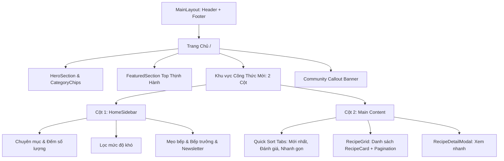

# Lab 7 — FR-FTE-040: Hoàn thiện Trang chủ (/): Tích hợp Header, Footer, Sidebar và Main Content công thức mới

## 1. Mục tiêu

Hoàn thiện giao diện Trang chủ (`/`) của dự án Culinary Blog theo kiến trúc bố cục 2 cột chuyên nghiệp: tích hợp liền mạch thanh điều hướng Header và chân trang Footer dùng chung, xây dựng Sidebar ẩm thực đa tiện ích (Chuyên mục, Mức độ chế biến, Mẹo nấu ăn, Bếp trưởng nổi bật, Bản tin) và khu vực Main Content công thức mới nhất sử dụng `RecipeGrid` với phân trang thực tế.

## 2. Phạm vi triển khai

- **Tích hợp Header & Footer toàn cục**: Sử dụng cấu trúc `MainLayout` (`src/app/(main)/layout.tsx`) để Header và Footer bao bọc toàn bộ nội dung trang chủ, đảm bảo đồng nhất phiên đăng nhập và điều hướng.
- **Xây dựng `HomeSidebar` (`src/components/home/HomeSidebar.tsx`)**:
  - *Chuyên Mục Nấu Ăn*: Danh sách các nhóm món ăn (Bún phở, Cơm xôi, Kho rim, Canh tiềm, Xào luộc, Tráng miệng) kèm huy hiệu số lượng công thức thực tế.
  - *Mức Độ Chế Biến*: Bộ lọc 4 cấp độ (Tất cả, Dễ làm, Vừa phải, Nâng cao).
  - *Mẹo Bếp Hôm Nay*: Hộp mẹo vặt ẩm thực dân gian được xoay vòng ngẫu nhiên.
  - *Bếp Trưởng Nổi Bật*: Danh sách các tác giả tiêu biểu trong cộng đồng.
  - *Bản Tin Món Ngon*: Form đăng ký email nhận thực đơn tuần với phản hồi tương tác.
- **Khu vực Main Content Công Thức Mới**:
  - Thiết kế bố cục 2 cột responsive (`grid grid-cols-1 lg:grid-cols-4 gap-8`).
  - Thanh chọn sắp xếp nhanh (Mới nhất, Đánh giá cao, Nhanh gọn).
  - Dải huy hiệu bộ lọc đang kích hoạt kèm nút xóa nhanh từng điều kiện hoặc xóa tất cả.
  - Nhúng component `RecipeGrid` (từ nhiệm vụ `FR-FTE-041`) xử lý phân trang thực tế (4 món/trang), tự động cuộn lên đầu danh sách khi chuyển trang.
- **Các phần bổ trợ**:
  - Giữ vững `HeroSection` với ô tìm kiếm nhanh và bảng chỉ số ẩm thực.
  - `CategoryChips` cuộn ngang dạng carousel.
  - `FeaturedSection` tuyển chọn các món ăn có điểm rating cao nhất tuần.
  - `Community Callout Banner` kêu gọi cộng đồng chia sẻ món ngon gia truyền.
  - `RecipeDetailModal` xem nhanh thông số món ăn ngay tại trang chủ mà không tải lại trang.

## 3. Danh sách file thay đổi và tạo mới

| STT | Đường dẫn file | Thao tác | Mô tả chi tiết |
| :---: | :--- | :---: | :--- |
| 1 | `culinary-blog/src/frontend/src/components/home/HomeSidebar.tsx` | Tạo mới | Component thanh bên (Sidebar) cho trang chủ với đầy đủ 5 widget tương tác. |
| 2 | `culinary-blog/src/frontend/src/components/home/index.ts` | Tạo mới | Xuất khẩu tập trung các component thuộc module home. |
| 3 | `culinary-blog/src/frontend/src/app/(main)/page.tsx` | Cập nhật | Tái cấu trúc trang chủ với bố cục 2 cột, kết nối HomeSidebar và RecipeGrid kèm phân trang. |

## 4. Đặc tả kiến trúc & Luồng dữ liệu

## 5. Kết quả kiểm thử

- `npm run build`: 9/9 routes biên dịch tĩnh và động thành công 100%.
- Không phát sinh lỗi console, tương thích hoàn toàn trên Desktop, Tablet và Mobile.
