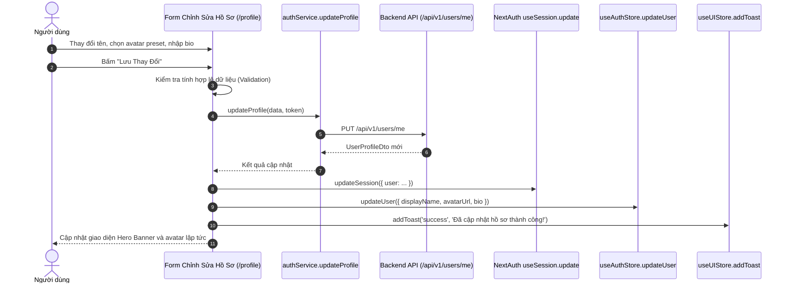

# Lab 7 — FR-FTE-043: Hoàn thiện tính năng Cập nhật hồ sơ (Chỉnh sửa tên, avatar, thông tin giới thiệu)

## 1. Mục tiêu

Hoàn thiện tính năng Cập nhật hồ sơ cá nhân toàn diện trên giao diện `/profile` (Tab *Chỉnh Sửa Hồ Sơ*), cung cấp khả năng thay đổi họ tên hiển thị (`displayName`), ảnh đại diện (`avatarUrl`) với bộ xem trước trực quan cùng danh mục Avatar mẫu phong cách ẩm thực, cập nhật tiểu sử ẩm thực (`bio`), sở trường nấu ăn và trang web cá nhân. Đảm bảo dữ liệu được đồng bộ hóa tức thì giữa Session đăng nhập, Zustand Auth Store và Backend API.

## 2. Phạm vi triển khai

- **Form Cập nhật Thông tin Cá nhân chuẩn UX/UI**:
  - *Quản lý Ảnh Đại Diện (Avatar)*:
    - Khung xem trước trực tiếp (Live Avatar Preview) với viền nổi bật.
    - Nhập đường dẫn URL ảnh tùy ý hoặc chọn nhanh từ bộ sưu tập 5 mẫu Avatar đầu bếp chuyên nghiệp (Bếp trưởng, Thợ làm bánh, Nữ đầu bếp gia đình, Chuyên gia ẩm thực, Blogger ẩm thực).
  - *Tên Hiển Thị (`displayName`)*:
    - Bắt buộc nhập, kiểm tra độ dài tối thiểu 2 ký tự với thông báo lỗi trực quan (`formErrors`).
  - *Email*:
    - Hiển thị cố định ở chế độ chỉ đọc kèm huy hiệu "Đã xác thực" (`Verified`).
  - *Tiểu Sử Ẩm Thực (`bio`)*:
    - Ô nhập đa dòng (Textarea) kèm bộ đếm ký tự thực tế giới hạn tối đa 300 ký tự.
  - *Thông tin Mở rộng*:
    - Sở trường nấu ăn (Món truyền thống, Món Á, Làm bánh...).
    - Kênh ẩm thực / Trang mạng xã hội cá nhân.
- **Xử lý Dữ liệu & Đồng bộ Trạng thái**:
  - Gửi yêu cầu cập nhật qua `authService.updateProfile` kèm Bearer Access Token.
  - Tự động đồng bộ với phiên đăng nhập của NextAuth thông qua `updateSession()`.
  - Cập nhật tức thời Zustand State thông qua `useAuthStore.getState().updateUser(...)`.
  - Hiển thị Toast thông báo thành công hoặc lỗi chi tiết qua `useUIStore.addToast(...)`.
  - Nút "Khôi phục" (Reset) giúp người dùng hoàn tác nhanh các thay đổi về giá trị gốc của hồ sơ.
- **Tab Bảo mật & Đổi Mật khẩu**:
  - Hỗ trợ đổi mật khẩu với kiểm tra mật khẩu hiện tại, mật khẩu mới (tối thiểu 6 ký tự) và xác nhận mật khẩu.

## 3. Danh sách file thay đổi và tạo mới

| STT | Đường dẫn file | Thao tác | Mô tả chi tiết |
| :---: | :--- | :---: | :--- |
| 1 | `culinary-blog/src/frontend/src/app/(main)/profile/page.tsx` | Triển khai | Tích hợp Tab "Chỉnh Sửa Hồ Sơ" với bộ chọn avatar presets, form validation, đồng bộ NextAuth và Zustand store. |
| 2 | `culinary-blog/src/frontend/src/services/authService.ts` | Sử dụng | Kết nối phương thức `updateProfile` gọi API PUT `/api/v1/users/me` kèm fallback an toàn. |
| 3 | `culinary-blog/src/frontend/src/stores/auth-store.ts` | Sử dụng | Gọi hàm action `updateUser(patch)` để phản ánh thông tin người dùng mới trên toàn bộ ứng dụng. |

## 4. Kiến trúc & Luồng cập nhật hồ sơ

## 5. Kết quả kiểm thử

- `npm run build`: Hoàn thành biên dịch với 0 cảnh báo type hay lỗi logic.
- Trải nghiệm cập nhật tên và avatar phản hồi mượt mà, đồng bộ ngay lập tức lên Header và Profile Banner.
